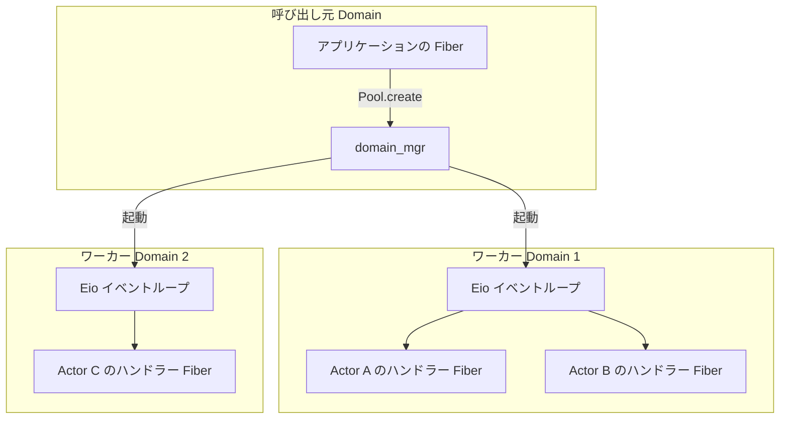
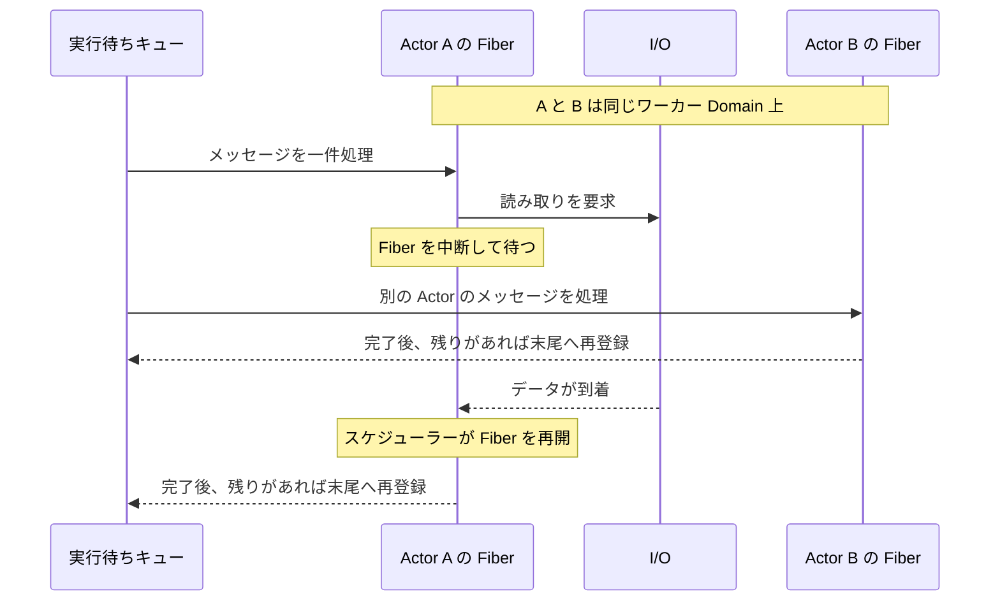
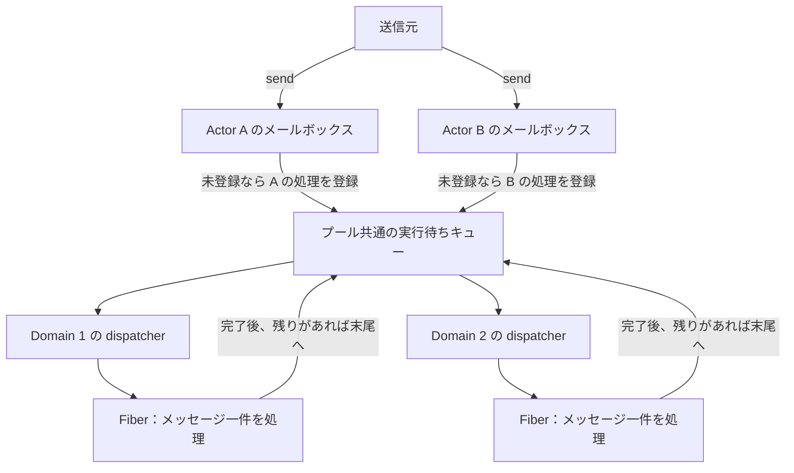

# Acterious

Acterious は、OCaml 5.5.0 と [Eio](https://ocaml-multicore.github.io/eio/eio/Eio/index.html) で[並行・並列処理](https://ocaml.org/manual/5.5/parallelism.html)とアクターモデルを学ぶための小さなフレームワークです。固定数のワーカー Domain からなるプール上で、型付きメールボックスと状態を持つ Actor を動かします。各 Actor のメッセージは到着順に 1 件ずつ処理され、ハンドラーが I/O などで待機している間は同じ Domain 上で他の Actor が動きます。

## ビルドと実行

OCaml 5.5.0 以降、Dune 3.9 以降、Eio 1.4 以降（`eio` および `eio_main`）が必要です。手元に OCaml 5.5.0 の switch がすでにある場合は、最初の 2 行は不要です。

```sh
opam switch create . 5.5.0
eval $(opam env)
opam install 'dune>=3.9' 'eio>=1.4' 'eio_main>=1.4'
dune build
dune exec examples/counter.exe
dune runtest
```

サンプルの [examples/counter.ml](examples/counter.ml) は、カウンタ用の Actor に `10` と `20` を足したあと、表示用の Actor に合計値を送って `合計: 30` と出力します。Actor の宛先（`'message Actor.t`）には受信できるメッセージの型が付くため、型が合わない送信はコンパイル時に弾かれます。

## 基本の使い方

[Eio_main.run](https://ocaml-multicore.github.io/eio/eio_main/Eio_main/index.html) と [Eio.Switch.run](https://ocaml-multicore.github.io/eio/eio/Eio/Switch/index.html) の内側でワーカープールを作り、その上に Actor を起動します。`Actor.spawn` には初期状態と、現在の状態およびメッセージから次の状態を返すハンドラーを渡します。

```ocaml
open Acterious

let () =
  Eio_main.run
  @@ fun env ->
  Eio.Switch.run
  @@ fun sw ->
  let pool = Pool.create ~sw ~domain_mgr:(Eio.Stdenv.domain_mgr env) ~domains:2 () in
  Fun.protect
    ~finally:(fun () -> Pool.shutdown pool)
    (fun () ->
       let counter =
         Actor.spawn pool ~initial:0 (fun total amount ->
           let total = total + amount in
           Printf.printf "%d\n%!" total;
           total)
       in
       if not (Actor.send counter 10) then failwith "送信先が終了しています";
       if not (Actor.send counter 20) then failwith "送信先が終了しています";
       Actor.stop counter;
       Actor.join counter)
;;
```

プールを使う箇所は [Fun.protect](https://ocaml.org/manual/5.5/api/Fun.html) で囲み、`finally` で必ず `Pool.shutdown` を呼んでください。ワーカーは受理済みのメッセージを最後まで処理するため親からの[キャンセルを遮蔽](https://ocaml-multicore.github.io/eio/eio/Eio/Cancel/index.html)しており、Switch を抜けるだけでは停止しません。なお、`Actor.spawn`、`send`、`stop` は完了を待たずにすぐ戻るため Eio の外（通常の Domain）からも呼べますが、`Pool.create`、`Pool.shutdown`、`Actor.join` は Eio の Fiber 上で呼び出す必要があります。

## Domain と Fiber の役割

[Domain](https://ocaml.org/manual/5.5/api/Domain.html) は CPU コアを使って並列に動く実行単位です。`Pool.create ~domains:2` を呼ぶと、呼び出し元とは別に 2 つのワーカー Domain が立ち上がり、それぞれで Eio のイベントループが動きます。Domain 数はプール作成時に固定され、Actor をいくつ起動しても増えません。ワーカー数は [Domain.recommended_domain_count](https://ocaml.org/manual/5.5/api/Domain.html) を目安に設定してください。



[Fiber](https://ocaml-multicore.github.io/eio/eio/Eio/Fiber/index.html) は 1 つの Domain 内で処理を切り替える軽量な実行単位です。Acterious は Actor ごとに Fiber を常駐させるのではなく、メッセージを 1 件処理するたびに Fiber を起動します。ハンドラーが Eio の I/O や [Eio.Promise.await](https://ocaml-multicore.github.io/eio/eio/Eio/Promise/index.html) で待機すると Fiber が中断され、同じ Domain 上で他の Actor の処理が進みます。



Fiber の切り替えは協調的に行われるため、長時間の計算や標準ライブラリのブロッキング I/O を行うと、その間は同じ Domain の他の Fiber が動けません。I/O には [Eio.Flow](https://ocaml-multicore.github.io/eio/eio/Eio/Flow/index.html) などの Eio 対応 API を使い、重い計算では適宜 [Eio.Fiber.yield](https://ocaml-multicore.github.io/eio/eio/Eio/Fiber/index.html) を挟むか [Eio.Executor_pool](https://ocaml-multicore.github.io/eio/eio/Eio/Executor_pool/index.html) へ処理を分けてください。

## メールボックスと実行順序

スケジューリングは、Actor ごとのメールボックスとプール共通の実行待ちキューという 2 段の [Queue](https://ocaml.org/manual/5.5/api/Queue.html) で行います。`Actor.send` でメールボックスにメッセージが入ると、その Actor が実行待ちでも処理中でもないときだけ、1 件分の処理タスクが実行待ちキューに追加されます。



各 Actor の登録状態は `scheduled` フラグで管理されており、実行待ちキューへの登録から 1 件の処理が終わるまで（Eio での待機中も含めて）`true` に保たれます。これにより、同じ Actor の後続メッセージが追い越して実行されることはありません。また、1 件処理するごとにメールボックスの残りを実行待ちキューの末尾へ並び直すため、特定の Actor にメッセージが集中しても他の Actor に順番が回ります。

ワーカーが複数ある場合や I/O 待機を含む場合は、異なる Actor 間でどちらが先に終わるかは決まりません。同じ Actor でもメッセージごとに担当 Domain が変わることがあるため、状態は [Domain ローカルストレージ（DLS）](https://ocaml.org/manual/5.5/api/Domain.DLS.html)に置かず、ハンドラーの引数と戻り値で受け渡してください。処理の前後でプール共通の [Mutex](https://ocaml.org/manual/5.5/api/Mutex.html) を解放・取得するため、前のワーカーが更新した状態は次の担当ワーカーから安全に参照できます（[メモリモデル](https://ocaml.org/manual/5.5/memorymodel.html)参照）。ただし、状態やメッセージの値自体はコピーされないため、可変なデータを外部と共有する場合は呼び出し側で同期してください。

## 送信と終了の保証

`Actor.send` は、メールボックスへメッセージを追加できれば `true`、Actor またはプールがすでに閉じていれば `false` を返します。メールボックスに容量制限はないため空き待ちでブロックすることはなく、同じ送信元からのメッセージ順序は常に保たれます。なお、`true` はメールボックスへの追加を表すだけでハンドラーの完了は意味しないため、処理結果を受け取りたい場合は返信用の [Eio.Promise](https://ocaml-multicore.github.io/eio/eio/Eio/Promise/index.html) や返信先 Actor をメッセージに含めて渡します（[examples/counter.ml](examples/counter.ml) 参照）。

個別の Actor を終了するときは、`Actor.stop` で新規送信を締め切ってから `Actor.join` で処理の完了を待ちます。`stop` は実行中のハンドラーを中断せず即座に戻り、締め切り前に受理されたメッセージは最後まで処理されます。`join` の待機中は呼び出し元の Fiber が中断されるだけなので同じ Domain の他の Fiber は動作でき、もし待機中に呼び出し元がキャンセルされても Actor 自体は止まりません。デッドロックを避けるため、ハンドラー内からは `join` を呼ばないでください。

`Pool.shutdown` は、プール内の全 Actor への送信と新規 Actor の起動を締め切り、受理済みの処理と全ワーカーの終了を待ちます。実行待ちキューが空になっても、I/O 待ちのハンドラーが残っている間はワーカーを止めません。ハンドラーが無限に待機すると `shutdown` も戻らなくなるため、外部 I/O などを待つ場合は [Eio.Time](https://ocaml-multicore.github.io/eio/eio/Eio/Time/index.html) でタイムアウトを設けてください。また、`shutdown` 後はプール内の別 Actor へ返信を送れなくなるため、返信を伴う処理では [examples/counter.ml](examples/counter.ml) のように要求元の Actor を先に `stop`・`join` してから返信先とプールを閉じてください。

## ハンドラーの例外

ハンドラーで未捕捉の例外が起きると、その Actor は閉鎖されて残りの未処理メッセージを破棄します。例外と[バックトレース](https://ocaml.org/manual/5.5/api/Printexc.html)はその Actor 内に保存され、ワーカーや他の Actor は影響を受けずに動き続けます。保存された例外は、その Actor に `Actor.join` を呼んだときに [Printexc.raise_with_backtrace](https://ocaml.org/manual/5.5/api/Printexc.html) で再送出されます。`Pool.shutdown` は個々の Actor の例外を送出しないため、成否を確認したい Actor には個別に `join` を呼んでください。

## テスト

`dune runtest` で実行される [test/actor_test.ml](test/actor_test.ml) では、FIFO 順序や状態の引き継ぎ、1 件ごとの交代、複数 Domain での並列実行に加え、単一 Domain 上でのパイプ I/O、待機中の直列性維持、キャンセルや例外発生時の後始末などを検証しています。タイミングによる不安定さを避けるため、スリープは使わず [Eio.Promise](https://ocaml-multicore.github.io/eio/eio/Eio/Promise/index.html) と標準の [Condition](https://ocaml.org/manual/5.5/api/Condition.html) で実行順を揃えています。

## コーディング規約

整形には OCamlFormat 0.29.0 の `janestreet` プロファイルを使います。
命名やコメントは [OCaml Programming Guidelines](https://ocaml.org/docs/guidelines) を参考にし、
関数・変数・型は `snake_case`、モジュール・コンストラクターは大文字で始めます。
公開 API の使い方はシグネチャの文書コメント（`(** ... *)`）、実装上の理由や不変条件は該当コードの通常コメント（`(* ... *)`）に記述します。
このプロジェクトでは、シグネチャも `.ml` にまとめます。

```sh
opam install 'ocamlformat=0.29.0'
dune fmt          # 整形を適用
dune build @fmt  # 整形のチェック
```

## 参考資料

公開 API と実装は [lib/acterious.ml](lib/acterious.ml) にまとめています。Eio の Fiber や Promise、Flow などの API も併せて参照してください。

- [OCaml 5.5 API リファレンス](https://ocaml.org/manual/5.5/api/index.html) / [OCaml 5.5.0 リリース情報](https://ocaml.org/releases/5.5.0)
- [Eio API リファレンス](https://ocaml-multicore.github.io/eio/eio/Eio/index.html) / [Eio 公式 README](https://github.com/ocaml-multicore/eio)
