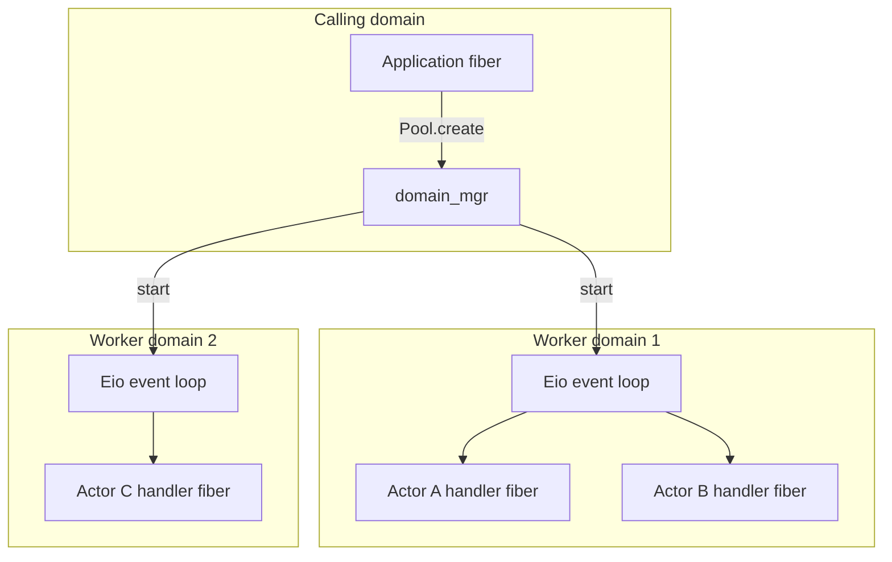
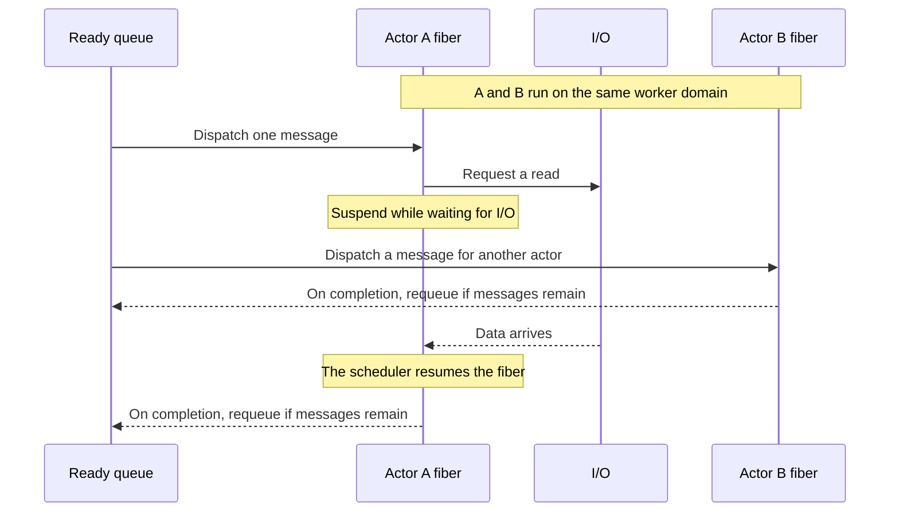
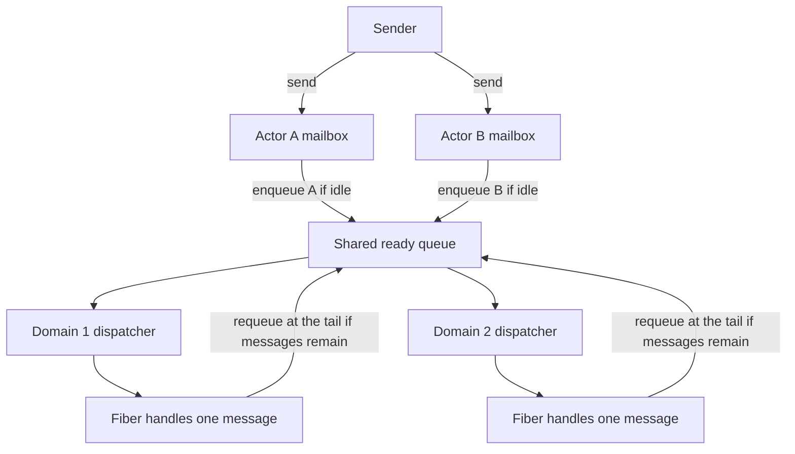

# Acterious

[日本語](README.ja.md)

Acterious is a small framework for learning the actor model and [concurrent and parallel programming](https://ocaml.org/manual/5.5/parallelism.html) with OCaml 5.5.0 and [Eio](https://ocaml-multicore.github.io/eio/eio/Eio/index.html). It runs actors with typed mailboxes and isolated state on a fixed-size pool of worker domains. Each actor handles messages one at a time in the order they reach its mailbox. While a handler waits on I/O or other Eio operations, other actors can run on the same domain.

## Build and run

You need OCaml 5.5.0 or later, Dune 3.9 or later, and Eio 1.4 or later (`eio` and `eio_main`). If you already have an active switch with OCaml 5.5.0 or later, you can skip the first two lines.

```sh
opam switch create . 5.5.0
eval $(opam env)
opam install 'dune>=3.9' 'eio>=1.4' 'eio_main>=1.4'
dune build
dune exec examples/counter.exe
dune runtest
```

The counter example in [examples/counter.ml](examples/counter.ml) adds `10` and `20` in one actor, then sends the total to another actor that prints it. An actor address (`'message Actor.t`) carries the type of messages it accepts, so sending a message of the wrong type fails at compile time.

## Basic usage

Create a worker pool inside [`Eio_main.run`](https://ocaml-multicore.github.io/eio/eio_main/Eio_main/index.html) and [`Eio.Switch.run`](https://ocaml-multicore.github.io/eio/eio/Eio/Switch/index.html), then spawn actors on it. Pass `Actor.spawn` an initial state and a handler that takes the current state and a message and returns the next state.

```ocaml
open Acterious

let () =
  Eio_main.run
  @@ fun env ->
  Eio.Switch.run
  @@ fun sw ->
  let pool = Pool.create ~sw ~domain_mgr:(Eio.Stdenv.domain_mgr env) ~domains:2 () in
  Fun.protect
    ~finally:(fun () -> Pool.shutdown pool)
    (fun () ->
       let counter =
         Actor.spawn pool ~initial:0 (fun total amount ->
           let total = total + amount in
           Printf.printf "%d\n%!" total;
           total)
       in
       if not (Actor.send counter 10) then failwith "The recipient has stopped";
       if not (Actor.send counter 20) then failwith "The recipient has stopped";
       Actor.stop counter;
       Actor.join counter)
;;
```

Wrap the code that uses the pool in [`Fun.protect`](https://ocaml.org/manual/5.5/api/Fun.html) and call `Pool.shutdown` in `finally`. Because workers shield themselves from parent [cancellation](https://ocaml-multicore.github.io/eio/eio/Eio/Cancel/index.html) to finish processing accepted messages, leaving the switch alone does not stop them.

`Actor.spawn`, `Actor.send`, and `Actor.stop` return without waiting for handlers to finish, so they can also be called from domains outside Eio. Call `Pool.create`, `Pool.shutdown`, and `Actor.join` from an Eio fiber.

## Domains and fibers

OCaml [`Domain`s](https://ocaml.org/manual/5.5/api/Domain.html) run in parallel on separate CPU cores. `Pool.create ~domains:2` starts two worker domains in addition to the calling domain, each running its own Eio event loop. The number of domains is fixed at pool creation and does not grow as you spawn more actors. Use [`Domain.recommended_domain_count`](https://ocaml.org/manual/5.5/api/Domain.html) as a guide when choosing the number of workers.



[`Fiber`s](https://ocaml-multicore.github.io/eio/eio/Eio/Fiber/index.html) are lightweight tasks that take turns running within a domain. Rather than keeping a long-lived fiber per actor, Acterious starts a fiber for each message it handles. When a handler waits on Eio I/O or [`Eio.Promise.await`](https://ocaml-multicore.github.io/eio/eio/Eio/Promise/index.html), its fiber suspends and another actor can run on the same domain.



Fiber scheduling is cooperative: a long computation or a blocking standard-library I/O call prevents other fibers on that domain from running. Use Eio APIs such as [`Eio.Flow`](https://ocaml-multicore.github.io/eio/eio/Eio/Flow/index.html) for I/O, and for CPU-bound work either call [`Eio.Fiber.yield`](https://ocaml-multicore.github.io/eio/eio/Eio/Fiber/index.html) periodically or offload it to [`Eio.Executor_pool`](https://ocaml-multicore.github.io/eio/eio/Eio/Executor_pool/index.html).

## Mailboxes and scheduling

Scheduling uses two levels of [`Queue`](https://ocaml.org/manual/5.5/api/Queue.html): a mailbox per actor and a ready queue shared by the pool. When `Actor.send` pushes a message to a mailbox, it enqueues a job for one message on the ready queue only if the actor has no queued or running job.



An actor's `scheduled` flag stays `true` from the time its job enters the ready queue until the handler finishes, including while it waits on Eio. This keeps later messages for the same actor from starting early. If messages remain when the handler finishes, the next job goes to the tail of the ready queue so other actors get a turn even when one actor receives many messages.

With multiple workers or handlers that wait on I/O, completion order across actors is unspecified. Because successive messages for the same actor may run on different domains, pass state through the handler's argument and return value rather than storing it in [domain-local storage (DLS)](https://ocaml.org/manual/5.5/api/Domain.DLS.html). Acquiring and releasing the pool's [`Mutex`](https://ocaml.org/manual/5.5/api/Mutex.html) around each step makes state updates visible to the next worker under the [OCaml memory model](https://ocaml.org/manual/5.5/memorymodel.html). State and message values are passed without copying, so synchronize access yourself if you share mutable data outside the actor.

## Sending messages and shutting down

`Actor.send` returns `true` when it adds the message to the mailbox and `false` when the actor or pool is already closed. Mailboxes are unbounded, so sending never blocks waiting for capacity, and messages from the same sender always keep their order. A `true` return value only confirms that the message was queued, not that its handler has finished; to receive a result, include an [`Eio.Promise`](https://ocaml-multicore.github.io/eio/eio/Eio/Promise/index.html) resolver or a reply actor in the message (see [examples/counter.ml](examples/counter.ml)).

To shut down an individual actor, call `Actor.stop` to close its mailbox to new sends, then call `Actor.join` to wait for it to finish. `stop` returns immediately without interrupting a running handler, and any messages accepted before `stop` run to completion. While `join` waits, only the calling fiber suspends, so other fibers on the same domain can run; canceling the waiting fiber leaves the actor running. To avoid deadlocks, do not call `join` from inside an actor handler.

`Pool.shutdown` closes the pool to new actors and sends, then waits for accepted work to finish and all workers to exit. Workers stay alive while handlers are waiting on I/O, even when the ready queue is empty. Because a handler that waits indefinitely also prevents `shutdown` from returning, use [`Eio.Time`](https://ocaml-multicore.github.io/eio/eio/Eio/Time/index.html) to set timeouts on external I/O. Once `shutdown` begins, sends within the pool are rejected, including replies. When one actor sends a reply to another (as in [examples/counter.ml](examples/counter.ml)), `stop` and `join` the sender before stopping the recipient and shutting down the pool.

## Handler exceptions

An uncaught exception in a handler closes that actor and discards its remaining messages. The actor stores the exception and backtrace, while workers and other actors keep running. Calling `Actor.join` on the actor re-raises the saved exception with its original backtrace via [`Printexc.raise_with_backtrace`](https://ocaml.org/manual/5.5/api/Printexc.html). Because `Pool.shutdown` does not raise actor exceptions, call `join` on individual actors to check whether they succeeded.

## Tests

The test suite in [test/actor_test.ml](test/actor_test.ml) (run with `dune runtest`) checks FIFO message order, state handoff, fair per-message turn-taking, and parallel execution across domains, as well as pipe I/O on a single domain, per-actor serialization while a handler is suspended, and cleanup after cancellation or exceptions. To avoid timing-dependent flakiness, the tests coordinate execution order with [`Eio.Promise`](https://ocaml-multicore.github.io/eio/eio/Eio/Promise/index.html) and the standard library's [`Condition`](https://ocaml.org/manual/5.5/api/Condition.html) instead of sleeping.

## Coding conventions

Formatting uses OCamlFormat 0.29.0 with the `janestreet` profile. Following the [OCaml Programming Guidelines](https://ocaml.org/docs/guidelines), functions, variables, and types use `snake_case`, while module and constructor names start with an uppercase letter. Document public API usage in signature doc comments (`(** ... *)`), and explain implementation rationale and invariants in regular comments (`(* ... *)`) next to the relevant code. This project keeps the module signature in the `.ml` file.

```sh
opam install 'ocamlformat=0.29.0'
dune fmt         # Apply formatting
dune build @fmt  # Check formatting
```

## References

The public API and implementation are in [lib/acterious.ml](lib/acterious.ml).

- [OCaml 5.5 API reference](https://ocaml.org/manual/5.5/api/index.html) · [OCaml 5.5.0 release notes](https://ocaml.org/releases/5.5.0)
- [Eio API reference](https://ocaml-multicore.github.io/eio/eio/Eio/index.html) · [Eio README](https://github.com/ocaml-multicore/eio)
