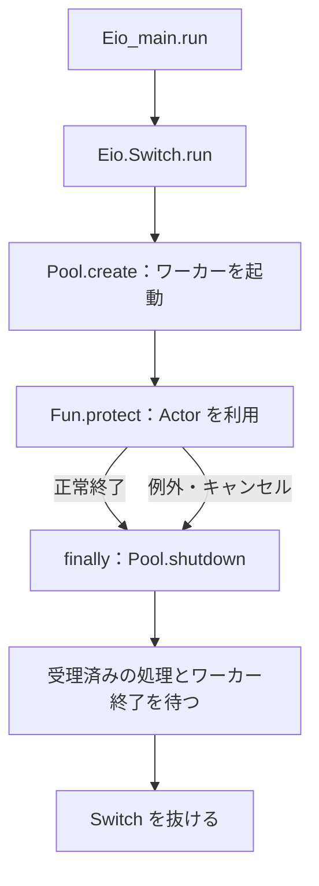
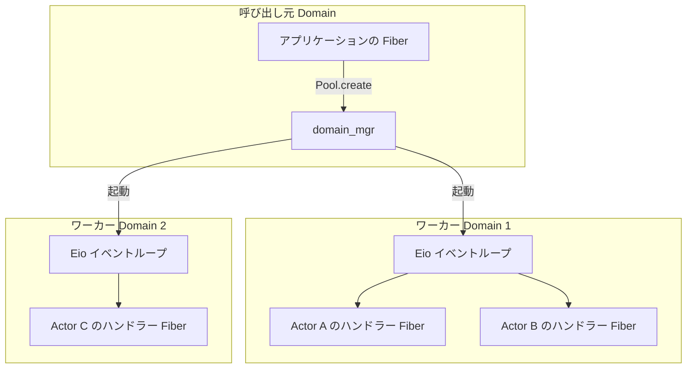
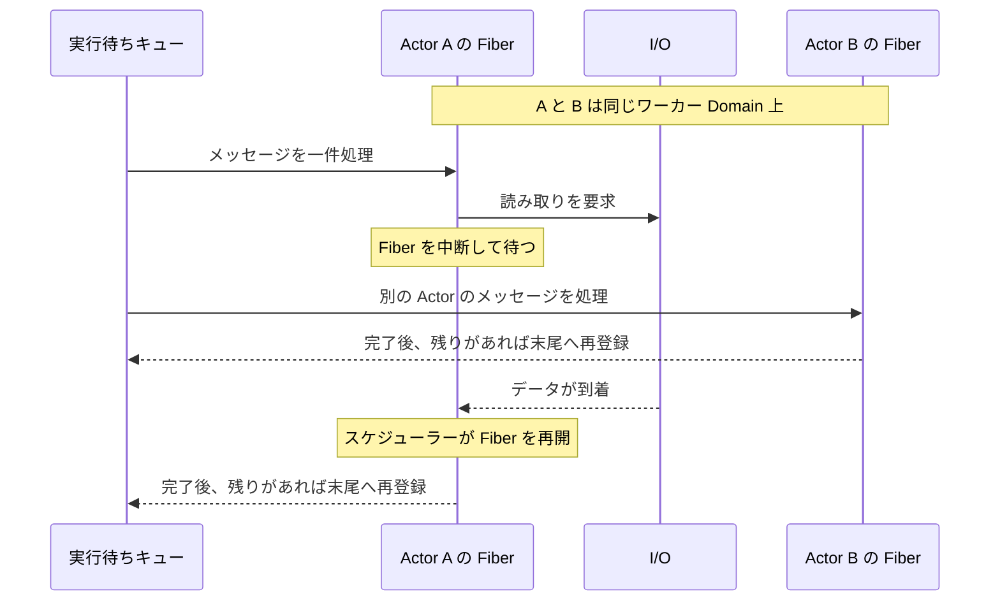
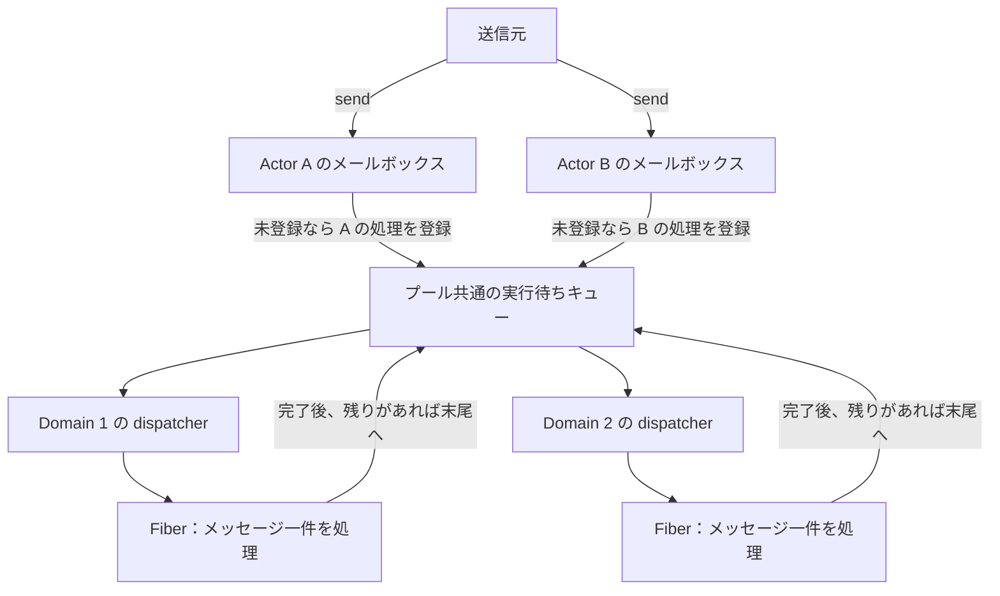
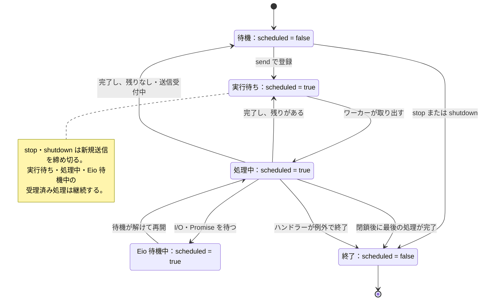
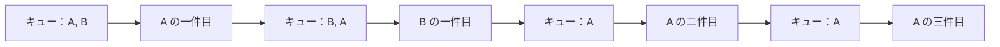
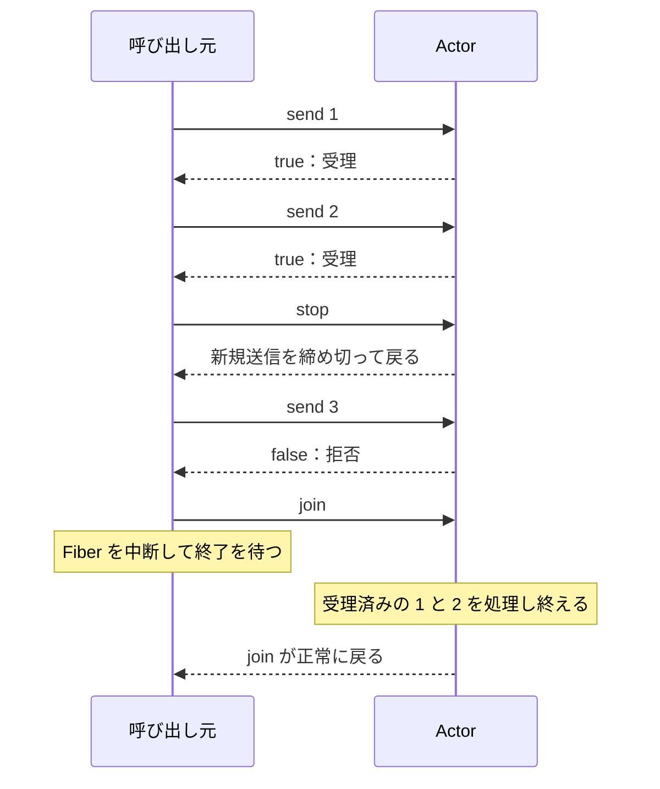
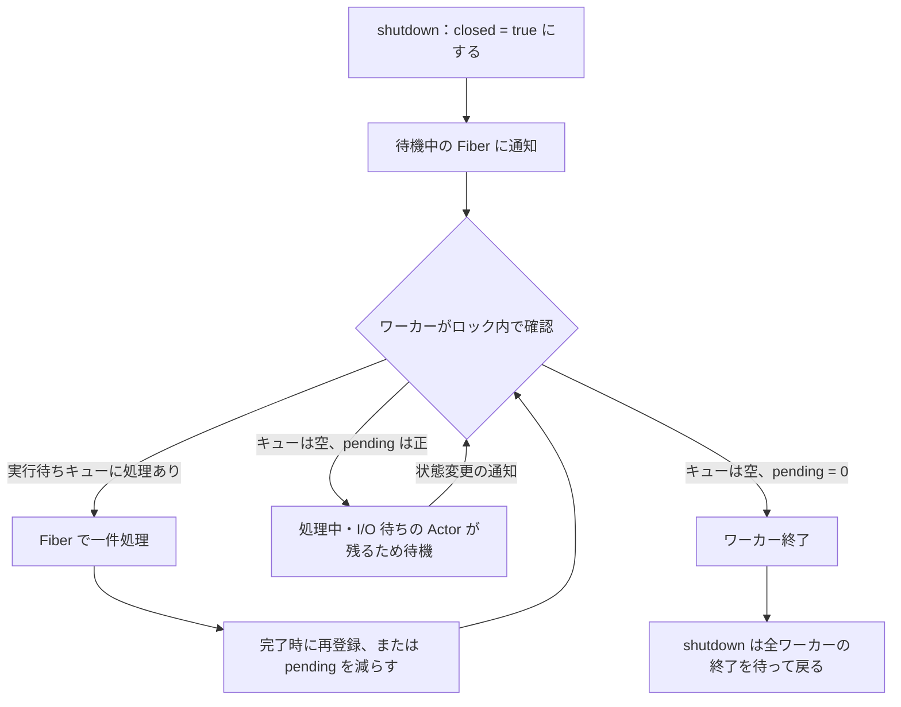
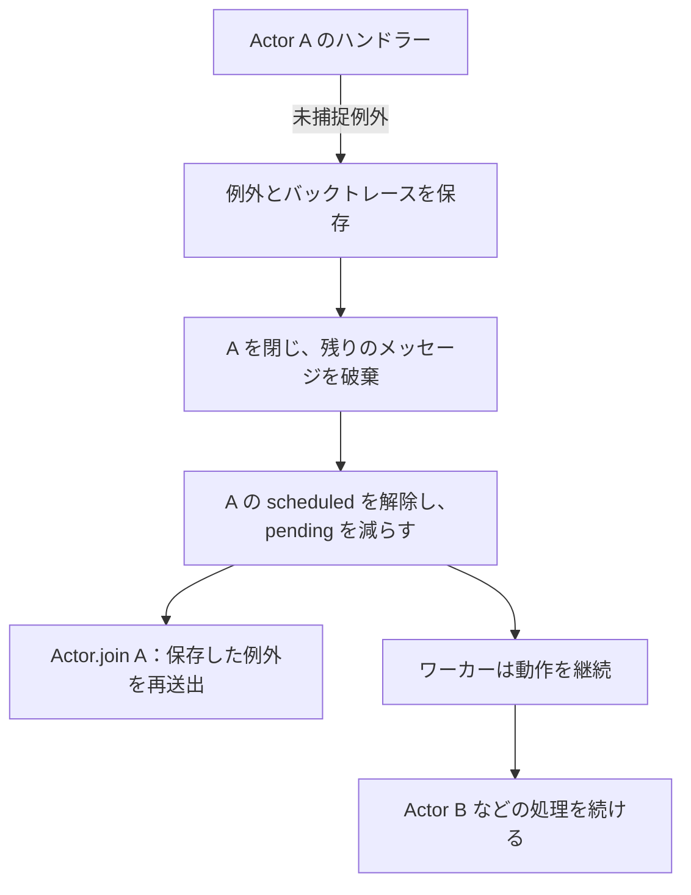

# Acterious

Acterious は、OCaml 5.5.0 と [Eio](https://ocaml-multicore.github.io/eio/eio/Eio/index.html) を用いて[並行・並列処理](https://ocaml.org/manual/5.5/parallelism.html)とアクターモデルを学ぶための軽量なフレームワークです。固定数のワーカー Domain からなるプール上で、型付きメールボックスと内部状態を持つ Actor を実行します。各 Actor に届いたメッセージは到着順に 1 件ずつ直列に処理されますが、ハンドラーが Eio の操作で待機している間は、同じ Domain 上で他の Actor の処理を進められます。

## ビルドと実行

ビルドと実行には、OCaml 5.5.0 以降、Dune 3.9 以降、Eio 1.4 以降、および実行バックエンドを選択する `eio_main` 1.4 以降が必要です。リポジトリのルートで以下のコマンドを実行すると、ローカルの opam switch の作成からビルド、サンプルの実行、テストまでを一通り行えます。すでに OCaml 5.5.0 以降の switch を利用している場合は、最初の 2 行を省略してください。

```sh
opam switch create . 5.5.0
eval $(opam env)
opam install 'dune>=3.9' 'eio>=1.4' 'eio_main>=1.4'
dune build
dune exec examples/counter.exe
dune runtest
```

付属のサンプル（`examples/counter.exe`）は、加算を受け付ける Actor と結果を表示する Actor がメッセージをやり取りするプログラムです。加算用の Actor に `10` と `20` を送ったあと、現在の合計値を表示用の Actor へ返信させ、`合計: 30` と出力します。各 Actor の宛先は受信できるメッセージの型でパラメータ化されているため、たとえば `int Actor.t` に文字列を送るような誤りはコンパイル時に型エラーとして検出されます。

## 基本の使い方

Actor を動かすには、まず [Eio_main.run](https://ocaml-multicore.github.io/eio/eio_main/Eio_main/index.html) と [Eio.Switch.run](https://ocaml-multicore.github.io/eio/eio/Eio/Switch/index.html) の内側でワーカープールを作成し、そのプール上に Actor を起動します。プールの作成には `Pool.create` を使い、Switch（`sw`）、環境から [Eio.Stdenv.domain_mgr](https://ocaml-multicore.github.io/eio/eio/Eio/Stdenv/index.html) で取得した [Domain manager](https://ocaml-multicore.github.io/eio/eio/Eio/Domain_manager/index.html)、およびワーカー数を指定します。作成したプールに対して初期状態とハンドラーを渡して `Actor.spawn` を呼び出すと、現在の状態とメッセージから次の状態を計算する Actor が起動します。

```ocaml
open Acterious

let () =
  Eio_main.run @@ fun env ->
  Eio.Switch.run @@ fun sw ->
  let pool =
    Pool.create ~sw ~domain_mgr:(Eio.Stdenv.domain_mgr env) ~domains:2 ()
  in
  Fun.protect ~finally:(fun () -> Pool.shutdown pool) (fun () ->
      let counter =
        Actor.spawn pool ~initial:0 (fun total amount ->
            let total = total + amount in
            Printf.printf "%d\n%!" total;
            total)
      in
      if not (Actor.send counter 10) then failwith "送信先が終了しています";
      if not (Actor.send counter 20) then failwith "送信先が終了しています";
      Actor.stop counter;
      Actor.join counter)
```

作成したプールは [Fun.protect](https://ocaml.org/manual/5.5/api/Fun.html) で囲み、`finally` 節で必ず `Pool.shutdown` を呼び出して終了させてください。各ワーカーは、受理済みのメッセージを最後まで処理するために親スコープからの[キャンセルを遮蔽](https://ocaml-multicore.github.io/eio/eio/Eio/Cancel/index.html)しており、Switch のスコープを抜けるだけでは停止しません。正常終了時だけでなく例外やキャンセルが発生した場合にもワーカーを確実に回収できるよう、Switch の内側で明示的に `Pool.shutdown` を実行する必要があります。



各 API を呼び出せる実行コンテキストは、その関数が完了待機を伴うかどうかによって決まります。`Actor.spawn`、`send`、`stop` の 3 つは待機を行わずに即座に制御を返すため、Eio を起動していない Domain からも呼び出せます。これに対し、プールを起動する `Pool.create` と完了を待つ `Actor.join` および `Pool.shutdown` は、Eio の Fiber 上で呼び出す必要があります。なお、Eio 対応に伴う旧 API からの変更点は、`Pool.create` に `~sw` と `~domain_mgr` を渡すことと、完了待機を Eio コンテキスト内で行うことの 2 点のみであり、`Actor` モジュールの各関数のシグネチャは従来と変わりません。

## Domain と Fiber の役割

[Domain](https://ocaml.org/manual/5.5/api/Domain.html) は、複数の CPU コアを使って処理を並列に実行するための単位です。たとえば `Pool.create ~domains:2` を呼び出すと、呼び出し元とは別に 2 つのワーカー Domain が生成され、それぞれで独立した Eio のイベントループが動作します。Domain の数はプール作成時に固定され、あとから Actor をいくつ起動しても増えることはありません。各 Actor は特定の Domain に束縛されず、その時点で空いているワーカー Domain 上で実行されます。ワーカー数を決める際は、呼び出し元の Domain も含めたプログラム全体の CPU 利用量を考慮し、[Domain.recommended_domain_count](https://ocaml.org/manual/5.5/api/Domain.html) で取得できる推奨上限数を目安に設定してください。



一方、[Fiber](https://ocaml-multicore.github.io/eio/eio/Eio/Fiber/index.html) は 1 つの Domain 内で複数の処理を協調的に切り替えて並行実行するための軽量な実行単位です。Acterious では Actor ごとに常駐する Fiber を持つのではなく、メッセージを 1 件処理するたびにハンドラー用の Fiber を新たに起動します。ハンドラーが Eio の I/O や [Eio.Promise.await](https://ocaml-multicore.github.io/eio/eio/Eio/Promise/index.html) で待機に入ると、実行中の Fiber は一時中断され、同じワーカー Domain 上で他の Actor のメッセージ処理を先に進められます。



ただし、Fiber の切り替えはあくまで協調的に行われるため、ハンドラー内でワーカー Domain を占有しないよう注意が必要です。Eio 上で動かしていても CPU 処理が自動的に時分割されるわけではなく、長時間の計算や標準ライブラリのブロッキング I/O を行うと、その間は同じ Domain 上の他の Fiber に実行権が移りません。入出力には [Eio.Flow](https://ocaml-multicore.github.io/eio/eio/Eio/Flow/index.html) などの Eio 対応 API を使用し、重い計算を行う場合は適宜 [Eio.Fiber.yield](https://ocaml-multicore.github.io/eio/eio/Eio/Fiber/index.html) を挟むか、[Eio.Executor_pool](https://ocaml-multicore.github.io/eio/eio/Eio/Executor_pool/index.html) などの計算用プールへ処理をオフロードしてください。

## メールボックスと実行順序

メッセージのスケジューリングは、Actor ごとのメールボックスとプール共通の実行待ちキューという 2 段階の [Queue](https://ocaml.org/manual/5.5/api/Queue.html) で構成されています。`Actor.send` でメールボックスにメッセージが追加された際、その Actor が実行待ちでも処理中でもなければ、メッセージ 1 件分の処理タスクがプールの実行待ちキューに登録されます。メールボックスが空の Actor は実行待ちキューに入らないため、メッセージを持たない Actor がワーカーの実行枠を消費することはありません。



同一 Actor 宛てのメッセージが常に 1 件ずつ直列に処理されることは、Actor ごとに管理される `scheduled` フラグによって保証されます。このフラグは実行待ちキューへの登録時に `true` となり、ハンドラーが Eio で待機している間も含めて、1 件分の処理が完了するまで解除されません。処理が完了した時点でメールボックスに次のメッセージが残っていれば、`scheduled` を `true` に保ったまま実行待ちキューの末尾へ再登録し、空であれば `false` に戻します。この仕組みにより、ハンドラーが途中で I/O などを待った場合でも、同じ Actor の後続メッセージが追い越して実行されることはありません。



メッセージを 1 件処理するたびに実行待ちキューの末尾へ並び直すため、特定の Actor にメッセージが集中しても他の Actor に実行機会が公平に回ります。たとえば、ワーカーが 1 つで I/O 待機が発生しない状況で、実行待ちキューに Actor A（未処理メッセージ 3 件）と Actor B（未処理メッセージ 1 件）がこの順で並んでいるとします。A が 1 件目の処理を終えると、A の次の処理は B の後ろに登録されるため、以下のように A と B が交互に処理を進めます。



一方、複数のワーカー Domain を動かす場合やハンドラー内で I/O 待機が発生する場合は、どのワーカーがいつ処理を進めるかが動的に変化します。異なる Actor の間では処理の完了順序が保証されないほか、同じ Actor であってもメッセージごとに実行を担当する Domain が入れ替わることがあります。そのため、Actor の内部状態は必ずハンドラーの引数と戻り値を通じて引き継ぎ、[Domain ローカルストレージ（DLS）](https://ocaml.org/manual/5.5/api/Domain.DLS.html)には保存しないようにしてください。

実行待ちキューや各種フラグなどの共有データは、プール共通の標準 [Mutex](https://ocaml.org/manual/5.5/api/Mutex.html) で保護されています。ロックの保持中に行う処理をキュー操作とフラグ更新のみに限定し、ハンドラーの実行や Eio の待機をロックの外で行うことで、Eio を起動していない外部 Domain からも短いロック取得だけでメッセージを送信できます。また、メッセージ処理の前後で同じ Mutex を解放・取得するため、OCaml の[メモリモデル](https://ocaml.org/manual/5.5/memorymodel.html)に基づき、あるワーカーが更新した Actor の状態を次の担当ワーカーから安全に参照できます。ただし、状態やメッセージの値自体はコピーされないため、可変なデータ構造を Actor の外部と共有する場合は呼び出し側で別途同期をとる必要があります。

ワーカーのジョブ待ちや `Actor.join` の完了待ちには、Mutex と協調して動作する [Eio.Condition.loop_no_mutex](https://ocaml-multicore.github.io/eio/eio/Eio/Condition/index.html) を使用しています。この関数は、あらかじめ待機リストへ Fiber を登録してから Mutex 内で条件を検査するため、条件確認から Fiber が中断するまでの間に別 Domain から通知が送られても取りこぼしが発生しません。Condition の通知はあくまで状態の再確認を促す合図として扱い、ジョブの有無や終了条件を満たしたかどうかは常にロック内で共有状態を参照して判断します。

## 送信と終了の保証

`Actor.send` は、対象 Actor のメールボックスへメッセージを追加できた場合に `true` を返し、Actor またはプールがすでに閉じている場合は `false` を返します。メールボックスには容量制限を設けていないため、短い Mutex のロック取得を除けば、空き待ちで送信側がブロックすることはありません。ただし、送信速度が処理速度を上回り続けると未処理メッセージの分だけメモリ使用量が増加します。なお、同一の送信元から送ったメッセージの順序は常に維持され、複数の送信元が同時に送信した場合はロックを取得した順にメールボックスへ格納されます。

`Actor.send` が返す `true` はメールボックスへの追加成功を表すのみであり、ハンドラーによる処理の完了は意味しません。送信元で処理結果を受け取りたい場合は、返信用の [Eio.Promise](https://ocaml-multicore.github.io/eio/eio/Eio/Promise/index.html) や返信先 Actor の宛先をメッセージに含めて渡し、ハンドラー側から結果を通知する設計にします。返信先 Actor を用いた具体的な実装方法は [examples/counter.ml](examples/counter.ml) を参照してください。

個別の Actor を終了させる際は、まず `Actor.stop` を呼び出して新規メッセージの受付を締め切ります。`stop` は複数回呼び出しても安全であり、実行中のハンドラーを中断することなく即座に制御を返します。締め切り前に受理されたメッセージは破棄されず、そのまま最後まで処理されます。また、`send` と `stop` が別々の Domain から同時に呼ばれた場合でも、同一の Mutex ロック内で受理と閉鎖を判定するため、一度 `true` を返して受理したメッセージが競合によって失われることはありません。

締め切った Actor の処理がすべて完了するのを待つには、`Actor.join` を使用します。受理されたメッセージの処理は送信時点から順次始まりますが、`join` 自体はメッセージ受付を締め切らないため、通常は先に `stop` を呼んでから実行します。待機中は呼び出し元の Fiber が中断されるだけであり、同じ Domain 上の他の Fiber はそのまま実行を続けられます。もし待機中に呼び出し元の Fiber がキャンセルされても Actor 自体は停止せず、あとから再度 `join` を呼び出して完了を待つことができます。ただし、自己待ちや循環待ちによるデッドロックを防ぐため、ハンドラー内からは `join` を呼び出さないでください。



プール全体を終了させる `Pool.shutdown` は、プール内の全 Actor への新規送信と新たな Actor の起動を締め切ったうえで、受理済みメッセージの処理完了と全ワーカーの終了を待機します。このとき、実行待ちキューが空になっていても、I/O などで待機中のハンドラーが残っている間はワーカーを停止させません。プール内部では実行待ちまたは処理中の Actor 数を `pending` カウンタとして管理しており、`pending` が `0` になったことを確認してから全ワーカーを終了させます。`stop` と同様、`shutdown` も複数回呼び出して構いません。



`Pool.shutdown` を安全に完了させるには、ハンドラーの待機時間と Actor 間の終了順序に注意が必要です。まず、プールの終了処理は受理済みメッセージの完遂を優先してキャンセルから保護されているため、ハンドラーが外部 I/O などで無期限に待機し続けると `shutdown` も戻らなくなります。待機を伴う処理では、[Eio.Time](https://ocaml-multicore.github.io/eio/eio/Eio/Time/index.html) を用いてハンドラー側で適切なタイムアウトを設定してください。また、`shutdown` の呼び出し後はプール内の全 Actor への送信が締め切られるため、ハンドラー内から同じプール上の別 Actor へ返信を送ることもできなくなります。返信を伴う構成では、[examples/counter.ml](examples/counter.ml) のように先に送信元となる Actor を `stop` と `join` で完了させ、その後に返信先 Actor を閉じてからプール全体をシャットダウンしてください。

## ハンドラーの例外

ハンドラー内で捕捉されない例外が発生した場合、その Actor は即座に失敗状態へ遷移し、同じプール上の他の Actor から隔離されます。失敗した Actor の内部には発生した例外と元の[バックトレース](https://ocaml.org/manual/5.5/api/Printexc.html)が保存され、新規の送信受付が締め切られるとともに、メールボックスに残っていた未処理のメッセージはすべて破棄されます。これは「受理済みのメッセージを最後まで処理する」という原則に対する唯一の例外です。なお、例外がワーカー自体を停止させることはないため、他の Actor はそのまま処理を継続できます。



失敗した Actor に保存された例外は、その Actor に対して `Actor.join` を呼び出した際に [Printexc.raise_with_backtrace](https://ocaml.org/manual/5.5/api/Printexc.html) によって再送出されます。`join` を複数回呼び出した場合も、毎回同じ例外とバックトレースが送出されます。`Pool.shutdown` は各 Actor で発生した例外を集約して送出しないため、処理の成否を確認したい Actor には個別に `join` を呼び出してください。なお、Acterious は学習用の最小構成として設計されており、失敗した Actor の自動再起動や監督ツリー、状態の永続化、プロセス間通信といった機能は備えていません。

## テストと検証範囲

`dune runtest` で実行されるテストスイート（[test/actor_test.ml](test/actor_test.ml)）は、アクターモデルの基本契約と Eio 上での並行・並列動作を網羅的に検証しています。基本動作としては、FIFO 順のメッセージ処理、状態の引き継ぎ、複数 Domain からの同時送信、1 件ごとの公平な実行交代、異なる Actor の並列実行を確認しています。これに加え、単一 Domain 上でのパイプ I/O や協調的待機、待機中における同一 Actor の直列性維持、`join` 待機中の他 Fiber の進行といった Eio 特有の挙動や、送信と停止の競合、待機中のハンドラーを含む `shutdown`、親スコープがキャンセルされた際のリソース回収、例外の隔離とバックトレースの保持といった境界条件もテスト対象としています。

各テストは実行タイミングの揺らぎに左右されないよう、スリープによる時間待ちを行わず、[Eio.Promise](https://ocaml-multicore.github.io/eio/eio/Eio/Promise/index.html) や標準の [Condition](https://ocaml.org/manual/5.5/api/Condition.html) を用いて実行順序を明示的に制御しています。Eio による協調的な待機を検証するテストでは `Eio.Promise` で Fiber を中断させ、キューの順序や複数 Domain の並列性を検証するテストでは `Condition` でワーカー自体をブロックさせることで、検証対象の性質を明確に切り分けています。なお、これらのテストは機能面の正しさを検証するものであり、スループットやレイテンシを測定するベンチマークは含まれていません。

## 参考資料

Acterious の公開 API と各関数の詳細な契約は [lib/acterious.mli](lib/acterious.mli) に、内部実装は [lib/acterious.ml](lib/acterious.ml) に記載されています。標準ライブラリの仕様については [OCaml 5.5 API リファレンス](https://ocaml.org/manual/5.5/api/index.html) を、Eio の各モジュールについては [Eio API リファレンス](https://ocaml-multicore.github.io/eio/eio/Eio/index.html) を参照してください。本ドキュメント内の標準ライブラリへのリンクも、すべて対象バージョンである OCaml 5.5 のマニュアルを指しています。

並行・並列処理の背景や設計思想をより深く学ぶには、Fiber・Domain・キャンセル・同期の仕組みを解説した [Eio の公式 README](https://github.com/ocaml-multicore/eio) や、言語処理系の変更点をまとめた [OCaml 5.5.0 のリリース情報](https://ocaml.org/releases/5.5.0) が参考になります。
